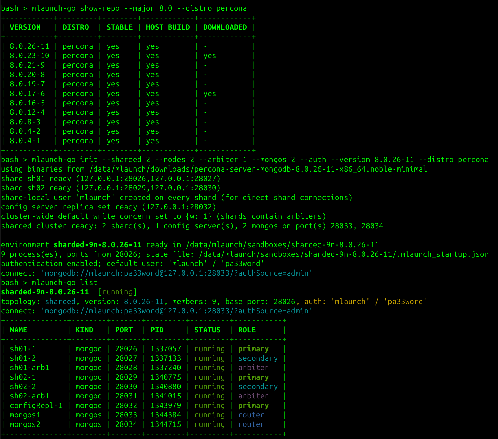

# mlaunch-go

[](https://go.dev/)
[](https://www.gnu.org/licenses/gpl-3.0)
[](https://github.com/PrzemekMalkowski/mlaunch-go/releases)

A modern, zero-dependency Go rewrite of [`mlaunch`](https://github.com/rueckstiess/mtools/tree/develop/mtools/mlaunch)
from the long-unmaintained mtools suite. It spins up local sandbox MongoDB
deployments — standalone, replica sets, and sharded clusters — and can
automatically download matching binaries for recent MongoDB versions
(including 8.x) or Percona Server for MongoDB.

## Features

- `init` / `start` / `stop` / `kill` / `destroy` / `list` / `show-repo`
  subcommands, modeled on mlaunch
- Topologies: standalone (`--single`), replica set (`--replicaset --nodes N`,
  with `--arbiter N`), sharded cluster (`--sharded N` with `--config` /
  `--mongos`)
- `--auth` support: keyfile-based internal auth plus a default
  `mlaunch` / `pa33word` root user (created via the localhost exception)
- Automatic binary download:
  - **MongoDB Community** from `fastdl.mongodb.org`, picking the tarball
    variant matching the host distro/arch (e.g. Ubuntu 24.04 x86_64 →
    `mongodb-linux-x86_64-ubuntu2404-…` with fallback to `ubuntu2204` etc.,
    since not every release ships every distro build)
  - **Percona Server for MongoDB** ("Linux - Generic" minimal tarballs) from
    `downloads.percona.com`, picking `olN` for RHEL-family hosts or the
    Ubuntu/Debian codename (`noble`, `jammy`, `bookworm`, …), e.g.
    `percona-server-mongodb-8.0.4-1-x86_64.ol9-minimal.tar.gz`
- Candidate URLs are probed with `HEAD` requests, best match first; archives
  are downloaded to the local folder (`--download-dir`, default `downloads`)
  and reused on subsequent runs
- `show-repo` lists the versions available for download (MongoDB release
  catalog and Percona GitHub tags), marking which have a build for your host
  and which are already downloaded
- No shell required: replica set initiation, primary election waits,
  `addShard`, user creation and SCRAM-SHA-256 authentication are done over a
  built-in minimal OP_MSG/BSON client — the modern server tarballs no longer
  bundle a shell, so this keeps things self-contained
- State is persisted to `<envdir>/.mlaunch_startup.json` (analogous to
  mlaunch's `.mlaunch_startup`), enabling `start`/`stop`/`list` later

## Screenshot
<table>
  <tr>
    <td align="center"></td>
  </tr>
</table>


## Install

Prebuilt Linux binaries (x86_64 and aarch64) are on the
[releases page](https://github.com/PrzemekMalkowski/mlaunch-go/releases):

```sh
curl -L https://github.com/PrzemekMalkowski/mlaunch-go/releases/latest/download/mlaunch-go_$(curl -s https://api.github.com/repos/PrzemekMalkowski/mlaunch-go/releases/latest | grep -oP '"tag_name": "v\K[^"]+')_linux_amd64.tar.gz | tar xz mlaunch-go
```

Or with Go ≥ 1.22:

```sh
go install github.com/PrzemekMalkowski/mlaunch-go@latest
```

## Build from source

```sh
git clone https://github.com/PrzemekMalkowski/mlaunch-go.git
cd mlaunch-go
go build -o mlaunch-go .
```

Requires Go ≥ 1.22. No third-party modules (stdlib only), so it builds offline.

## Usage Examples

```sh
# Standalone MongoDB 8.3.4, auto-downloaded for this host
./mlaunch-go init --single --version 8.3.4

# 3-node replica set on ports 27100-27102
./mlaunch-go init --replicaset --nodes 3 --version 8.0.26 --port 27100

# Replica set with 2 data nodes and 1 arbiter, with authentication
./mlaunch-go init --replicaset --nodes 2 --arbiter 1 --auth --version 8.0.26

# Sharded cluster: 2 shards x 3 nodes, 1 CSRS member, 1 mongos
./mlaunch-go init --sharded 2 --nodes 3 --version 8.0.26

# Percona Server for MongoDB (build suffix optional; builds are probed)
./mlaunch-go init --single --distro percona --version 8.0.4-1

# Use binaries you already have; skip downloading
./mlaunch-go init --replicaset --binary-dir ./mongodb-linux-x86_64-ubuntu2204-8.3.4/bin

# Pass extra options to every mongod after "--"
./mlaunch-go init --single --version 8.3.4 -- --wiredTigerCacheSizeGB 1

# See which URL would be downloaded, without downloading
./mlaunch-go init --dry-run --version 8.3.4
./mlaunch-go init --dry-run --distro percona --version 8.0.4

# What's available to download?
./mlaunch-go show-repo --major 8.0 --stable yes

# Manage the environments
./mlaunch-go list
./mlaunch-go stop --env replicaset-3n-8.0.26
./mlaunch-go stop --port 28027              # stop a single member (e.g. force a failover)
./mlaunch-go start --port 28027             # bring that member back
./mlaunch-go kill                           # SIGKILL
./mlaunch-go destroy --all                  # remove everything (asks for confirmation)
```

## How download resolution works

1. The host is detected from `/etc/os-release` and `GOARCH`
   (`x86_64`/`aarch64`).
2. A ranked list of tarball variants is built. Example for Ubuntu 24.04
   x86_64 with `--version 8.3.4`:

   ```
   https://fastdl.mongodb.org/linux/mongodb-linux-x86_64-ubuntu2404-8.3.4.tgz
   https://fastdl.mongodb.org/linux/mongodb-linux-x86_64-ubuntu2204-8.3.4.tgz
   https://fastdl.mongodb.org/linux/mongodb-linux-x86_64-ubuntu2004-8.3.4.tgz
   ...
   ```

3. Each URL is probed with `HEAD` (falling back to a 1-byte ranged `GET`);
   the first existing tarball wins. This is how e.g. `8.3.4` on Ubuntu 24.04
   correctly resolves to the `ubuntu2204` build when no `ubuntu2404` tarball
   was published for that release.
4. For Percona, the same probing covers unknown build suffixes (`-1`, `-2`, …)
   and platform flavors (`ol9`, `noble`, `jammy`, `bookworm`, …).
5. `--url` bypasses resolution entirely; `--binary-dir` bypasses download.

## Layout of a launched environment

```
sandboxes/
└── replicaset-3n-8.0.26/
    ├── .mlaunch_startup.json      # persisted state (nodes, ports, args, pids)
    ├── keyfile                    # only with --auth
    └── data/
        └── replset/
            ├── rs1/db/            # dbpath per member
            ├── rs1/mongod.conf    # editable; applied on next 'start'
            ├── rs1/mongod.log
            └── ...
```

Everything binds to `127.0.0.1` only.

## Not yet implemented (vs. mlaunch)

- x.509 / TLS options
- hidden/priority member options
- `mlaunch restart` (use `stop` + `start`)

## License

This project is licensed under the GNU General Public License v3.0 —
see the [LICENSE](LICENSE) file for details.

`mlaunch-go` is an independent rewrite inspired by
[mtools/mlaunch](https://github.com/rueckstiess/mtools) by Thomas Rückstieß
and contributors.
